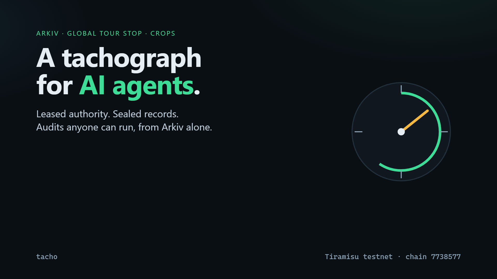

# Tacho — a tachograph for AI agents, on Arkiv



**An AI agent that spends a company's money gets its authority as a lease that a human must keep renewing, writes a sealed record of every attempt that nobody can delete, and can be audited by anyone from Arkiv alone — no Tacho server, no vendor database.**

[Live app](https://minkhanov.github.io/tacho-arkiv/) · [Demo video (≤ 3 min)](media/tacho-demo.mp4) · [Data contract: `/arkiv/schema.md`](arkiv/schema.md) · [Friction report: `/arkiv/friction.md`](arkiv/friction.md) · [On-chain evidence](demo/EVIDENCE.md) · MIT

Built for **Arkiv: Global Tour Stop** (9–18 October 2026), entered in all four CROPS tracks.

---

## The problem

A truck has a tachograph. It records driving time so that neither the driver nor the haulier can rewrite it, and a roadside inspector reads it without asking the company. That device exists because the party being supervised used to keep its own logbook.

AI agents are in the logbook era. A 12-truck haulier that lets an AI dispatcher buy fuel and pay tolls with a company card today trusts three things it cannot check:

- **What the agent was allowed to do.** The limits live in the agent vendor's dashboard. The vendor can change them, and so can anyone with the vendor's admin password.
- **What the agent actually did.** The log is a row in the vendor's database. After an overspend or a phantom purchase, it can be edited, lost in a migration, or gone when the vendor shuts down.
- **Whether a payment request really comes from that agent.** The fuel station sees an API call. It cannot check anything without calling the vendor.

The people harmed are specific: the **fleet owner** who disputes a 90 000 RUB fuel bill with no evidence of their own; the **fuel station** that pumped on the strength of a request it could not verify; the **driver** who gets blamed when the log is whatever the vendor says it is.

## What Tacho does

```
 principal (fleet owner)          agent (AI dispatcher)              counterparty (fuel station)
 ───────────────────────          ─────────────────────              ───────────────────────────
 issue MANDATE ──────────┐        before every action:               before it pumps:
 (limits, readonly,      │        1 read the mandate (live?)         1 read the RECORD
  15-min lease)          ▼        2 sum today's spend (u64 range)    2 $creator == mandate.agent?
 heartbeat: extendEntity ─► Arkiv ◄─ 3 decide                        3 mandate alive at record's block? (atBlock)
 revoke: deleteEntity ────►       4 write a RECORD, allowed or       4 daily cap recomputed at that block
                                    refused, sealed in one batch     5 not honoured before → write an ACK
                                  WebSocket: EntityDeleted → halt
                                         anyone: open the inspector, or curl the RPC
```

1. **The mandate is a lease.** The principal grants an agent wallet a mandate: what it may buy, a per-action cap and a daily cap. It is created `readonly` (the limits cannot change under the agent) and lives 15 minutes. The principal's heartbeat moves the expiry forward with `extendEntity`. No heartbeat, no authority: Arkiv drops the mandate from every query on its own. Revoking deletes it, and the agent, subscribed over WebSocket, halts on the `EntityDeleted` event.
2. **Every attempt leaves a sealed record.** Allowed or refused, each attempt becomes a `record` written by the agent's wallet. In the same atomic batch, the record is handed to `0x…dEaD`, an address nobody holds. From the block it lands, nobody can delete it, not even the operator who controls the agent's key. `readonly` blocks edits; `permissionlessExtension` lets any party to a dispute keep it alive. The details (vehicle, station, litres, the agent's rationale) are AES-256-GCM ciphertext; the key travels off-chain.
3. **Trust comes from `$creator`.** Anyone can write `project = tacho/v1`. A counterparty honours a record only if its `$creator` is the agent the mandate names, the mandate's `$creator` is the principal it expects, the mandate was alive at the record's block, and the daily cap still holds when recomputed from the agent's own records. It then writes a sealed `ack`, so the same record cannot be spent twice.

The [inspector](https://minkhanov.github.io/tacho-arkiv/) is a static page that reads Tiramisu directly. For any agent address it shows the live mandates with a lease countdown, a 24-hour tachograph disc of the day's attempts, every record with its seal, and, in red, records that claim the agent's mandate but were written by another wallet. Each panel prints its exact query and a `curl` that reproduces it.

## Why Arkiv, and what breaks without it

| Property Tacho depends on | On Arkiv | On Postgres / your own API | On IPFS | On a subgraph |
|---|---|---|---|---|
| Authority that **expires by itself** unless a human renews it | Entity Expiration + `extendEntity`: the database stops returning the mandate | A cron job the operator can switch off, and a row the operator can edit | No expiry, no queries | Mirrors a contract; expiry is your code |
| Evidence the **operator cannot delete** | Record owned by `0x…dEaD` from its first block, `readonly` | The operator owns the table | Unpinning makes it vanish; no authorship query | Indexer operator decides what is indexed |
| **Authorship** a third party can check | `$creator`, set by the protocol, queryable: `createdBy()` | A column anyone with write access can fill | CIDs say nothing about who wrote them | `msg.sender` only through a contract you have to deploy |
| A stranger can **query** it: "allowed spend today under mandate M" | Typed `u64` range query on the public RPC | Only through the operator's API | Not queryable | Needs someone to run the indexer |
| **Point-in-time** truth: was M alive at block N? | `atBlock(N)` on the same query | Only if the operator kept history honestly | — | Possible, with your own indexer |
| Agent **reacts instantly** to revocation | `watchEntityEvents` over WebSocket | Webhooks the operator controls | — | Polling |

Without Arkiv's expiry, `$creator` and ownership rules, Tacho is just another vendor log. That is the thing it exists to replace.

**Deliberately off Arkiv:** private keys and the AES data key (it rides in the URL fragment, which browsers never send to a server); plaintext details and any personal data (all demo data is synthetic); the payment itself; the agent's full LLM transcript.

## How Tacho uses each Arkiv feature

| Feature | How and why | What the user sees | Code |
|---|---|---|---|
| Attributes vs payload | Only what is queried is an attribute: `agent` addr, `mandate` key, `kind`/`verdict`/`reason` str, `amount` and `ts_ms` **u64** for ranges. Policy is public JSON payload; record details are an encrypted payload | Filters for today, large actions and refusals run on the node; the explorer shows ciphertext, not details | [`entities.ts`](src/core/entities.ts) |
| Queries | Compound predicates, a `u64` range for the daily cap, `createdBy()` for every trusted read, `NOT $creator = …` to find forgeries, `ownedBy(seal)` / `NOT $owner = seal` to prove every record is sealed, cursor pagination, `atBlock` for point-in-time checks | Spend-today bar, red "forged records" panel, "mandate was alive at this block" check | [`queries.ts`](src/core/queries.ts), [`reader.ts`](src/core/reader.ts), [`verify.ts`](src/core/verify.ts) |
| Entity Expiration | Different lifetimes per type: mandate = 15-minute lease; record and ack = 45-day dispute window chosen by the principal | Lease countdown ring; "kept 44d 23h" on every record | [`entities.ts`](src/core/entities.ts) |
| Lifetime Extension | `extendEntity` is the principal's heartbeat (owner-only). It is also how any party keeps a record alive during a dispute | "No live mandate" the moment the human stops renewing; a "keep 60 d" button on each record | [`ops.ts`](src/core/ops.ts), [`Agent.tsx`](web/src/pages/Agent.tsx) |
| Creation flags | Mandate: `readonly` + owner-only extension. Record and ack: `readonly` + `permissionlessExtension` | Badges on each entity; the extend button works from a wallet that does not own the record | [`entities.ts`](src/core/entities.ts) |
| `$creator` / `$owner`, ownership transfer | Trust is `$creator` only. Records and acks are transferred to the seal address in the creating batch | "agent" vs "forged" badges; "sealed: nobody can delete it" | [`verify.ts`](src/core/verify.ts) |
| WebSocket entity events | `watchEntityEvents` on a `webSocket()` transport with no `fromBlock` | The agent halts on revocation; the inspector updates without a refresh loop | [`clients.ts`](src/core/clients.ts), [`arkiv.ts`](web/src/arkiv.ts) |
| Batch writes | `predictEntityKeys` + `executeBatch({ creates, ownershipChanges })`: a record never exists unsealed, not even for one block | Every record is sealed from its first block | [`entities.ts`](src/core/entities.ts), [`ops.ts`](src/core/ops.ts) |

## CROPS: why each pillar

We enter all four tracks because each pillar protects a different person in the same story.

### Security — the counterparty who is asked to trust a request

- **Who is misled today:** the fuel station. A request "from the fleet's agent" is an API call; anyone who can reach the vendor's API, or write a line into its log, can claim to be that agent.
- **What changes on day one:** the station honours a record only if Arkiv says its `$creator` is the wallet the mandate names, and the mandate's `$creator` is the fleet it has a contract with. Tacho never filters by a field anyone can write. The demo writes a forged 90 000 RUB "allowed" record that copies every attribute — project, type, mandate key, verdict. The inspector paints it red, the station refuses it, and `test/tiramisu.int.test.ts` asserts it on Tiramisu.

### Censorship Resistance — the party that needs the evidence when it is inconvenient

- **Who is censored today:** the fleet owner and the station in a dispute with the agent vendor. The vendor decides what the log says, whether to hand it over, and whether it still exists after the vendor shuts down.
- **What changes on day one:** every record is owned by `0x…dEaD` from the block it lands, so nobody can delete it — not the vendor, not the fleet, not us. Anyone can read it from the public RPC with the `curl` above. There is no Tacho backend to switch off. Any party can extend a record's life while a dispute is open (`permissionlessExtension`).

### Privacy — the drivers and the fleet whose routes would otherwise be public

- **Who is exposed today:** a public audit trail of fuel purchases leaks vehicles, stations, routes and schedules. The usual answer is to keep the log private, in the vendor's database, which brings back every problem above.
- **What changes on day one:** the explorer shows eight short attributes — kind, amount, verdict, reason, time, mandate, project, type — and ciphertext. No names, plates or locations. The details are AES-256-GCM with the record's public fields as AAD; the key is shared off-chain between the parties. The principal sets how long evidence lives (the mandate's retention). All demo data is synthetic.

### Open Source — the next team building agents, and the auditors who check them

- **Who is locked out today:** every agent platform logs in its own format behind its own API, so an auditor, insurer or merchant needs a separate integration and permission per vendor.
- **What changes on day one:** [`tacho/v1`](arkiv/schema.md) is a documented data contract — entity types, attributes, lifetimes and the fourteen queries — and an MIT library. Any agent framework can write records, and any merchant or auditor can verify them, without asking us: [docs/integrate.md](docs/integrate.md) shows the three integration points, with and without this library.

## Run it yourself

**Read-only, nothing to install.** Open the [live app](https://minkhanov.github.io/tacho-arkiv/) and inspect the demo agent `0xF743C97D950ac24164Ef0B045AD90baC59BA6A8f`. Or ask Tiramisu directly:

```bash
curl -s https://rpc.tiramisu.db-chain.testnet.arkiv.network -H 'content-type: application/json' \
  -d '{"jsonrpc":"2.0","id":1,"method":"arkiv_query","params":["project = str('\''tacho/v1'\'') AND type = str('\''record'\'') AND $creator = addr(0xF743C97D950ac24164Ef0B045AD90baC59BA6A8f)",{"select":{"key":true,"owner":true,"creator":true,"attributes":true},"limit":"0x32"}]}'
```

Every record returned has `owner` = `0x000000000000000000000000000000000000dead` and `creator` = the agent.

**The full story on your own wallets** (Node ≥ 20.19):

```bash
git clone https://github.com/Minkhanov/tacho-arkiv && cd tacho-arkiv
npm ci
npm run tacho -- keys > .env       # four fresh testnet keys + a data key; never reuse them on mainnet
npm run tacho -- wallets           # fund the principal at https://hub.arkiv.network/faucet
npm run tacho -- fund --glm 1      # optional: share GLM with the other roles
npm run demo                       # issue → 6 attempts (2 refused) → honour → forge → extend → heartbeat → revoke → halt
npm run tacho -- inspect           # what anyone can see, with the queries
npm run dev                        # the inspector on http://localhost:5173
```

Step by step instead of `demo`: `issue`, `agent`, `heartbeat --every 60`, `verify <record>`, `honour <record>`, `forge`, `extend <record> --as counterparty`, `revoke`, `decrypt <record>`. `npm run tacho -- help` lists them.

## Reproduce the claims

| Claim | How to check |
|---|---|
| Every agent attempt, including refusals, is on Arkiv | Q3 in [schema.md](arkiv/schema.md): `$creator = agent`, `type = record` — refusals have `verdict = refused` and a `reason` |
| Records are sealed | Each record's `owner` is `0x…dEaD`; `creationFlags` = `readonly`, `permissionlessExtension` |
| The forged record is caught | Q4: `mandate = key(M) AND NOT $creator = addr(agent)` returns it; `#/record/<key>` shows "FORGED" |
| The mandate was a lease | `#/agent/…` shows the countdown; after revocation, Q1 returns nothing, and the last record's reason is `no_live_mandate` |
| The counterparty recomputes the cap | `#/record/<key>` lists the `atBlock` query it ran |

Transaction hashes and blocks for the demo run: [demo/EVIDENCE.md](demo/EVIDENCE.md).

## On-chain evidence

| Wallet | Role |
|---|---|
| `0x4B25c7E2e178D275Ff3285f2832Bb29D13Bd0591` | Principal: issues, renews and revokes mandates |
| `0xF743C97D950ac24164Ef0B045AD90baC59BA6A8f` | Agent: writes records (sealed) |
| `0x00cb37E03ec19cf0539cb50478B3CFf4e386ED59` | Counterparty: writes acks (sealed); extends evidence |
| `0x9288957a5294c7210796aBb6F8384a09Be35622E` | Forger: writes the fake record the app rejects |

## Tests

```bash
npm test                  # unit + flow tests on an in-memory Arkiv model (no network)
npm run test:integration  # the same flows on the live Tiramisu testnet (needs funded keys in .env)
npm run typecheck
```

The flow tests cover the caps, lease expiry, heartbeat, revocation, a foreign principal, sealing (the creator cannot delete), permissionless extension, double acknowledgement, a forged record, a record written after revocation, a rogue runtime that marks over-cap spending as allowed, clock skew, and batch atomicity. [`scripts/probe-read.ts`](scripts/probe-read.ts) and [`scripts/probe-write.ts`](scripts/probe-write.ts) reproduce every item in the friction report.

## Layout

```
src/core/      the library: data contract, policy, crypto, reader/writer, verification, agent ops
src/cli/       the CLI that plays principal, agent, counterparty and forger
web/           the inspector (Vite + React, static, reads Arkiv from the browser)
test/          vitest: unit, flow (in-memory Arkiv), integration (Tiramisu)
arkiv/         schema.md and friction.md
scripts/       friction probes and the evidence generator
docs/          integrate.md: add a tachograph to your own agent
video/         the demo video pipeline (narration, scenes, assembly)
demo/          public demo state and EVIDENCE.md (keys and hashes only)
```

## Limits and threat model

- **An agent can skip writing a record.** Tacho does not make that impossible; it makes it useless: the counterparty pays only against a live, sealed record from the mandated agent.
- **The agent writes `ts_ms` itself.** The counterparty compares it with the block time and fails anything more than 120 s off.
- **The policy payload is public** so that strangers can verify against it. It holds limits, not personal data.
- **Demo-grade key handling.** The CLI reads testnet keys from `.env`. A production agent would hold its key in an HSM or a wallet service; the principal signs from a hardware wallet.
- **Testnet only.** Tiramisu is a testnet; the 45-day retention and 15-minute lease are demo values.

## Licence

MIT. See [LICENSE](LICENSE). Built with the official [`@arkiv-network/sdk`](https://www.npmjs.com/package/@arkiv-network/sdk) 0.8.1 and viem. Written with Claude (Anthropic) as a coding assistant.
